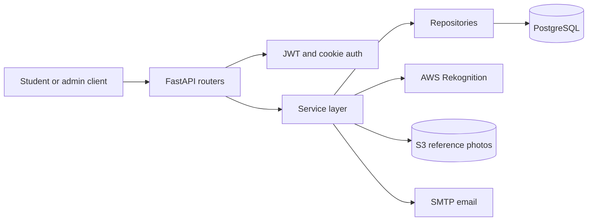

# Ave Geofence Attendance API

Backend API for geofence-based student attendance. Administrators define circular geofences for classes or events, and students record attendance with a fence code, their current location, and a face-liveness check.

The API verifies the liveness session, compares the captured face with the student's stored reference photo, checks that the student is inside the geofence, and prevents duplicate attendance records.

## Features

- Email-verified signup with college, department, matric number, and profile photo.
- Profile photo validation with Amazon Rekognition and storage in Amazon S3.
- Password login with JWT access tokens and an HTTP-only refresh-token cookie.
- Logout, token refresh, and password reset by email.
- Role-based authorization for administrators and students.
- Geofence creation with a unique six-character fence code.
- Validation for geofence start and end times, radius, and active status.
- Attendance verification with:
  - AWS Rekognition Face Liveness.
  - Face comparison against the student's S3 reference photo.
  - Fence-code validation.
  - Latitude and longitude checks against the geofence radius.
  - Duplicate-attendance prevention.
- Attendance listing for the geofence creator.
- Request timing middleware and centralized error responses.
- Alembic migrations, including college and department seed data.

## Architecture



Routers handle HTTP concerns, services implement attendance and account rules, and repositories isolate database access. Background tasks send email without blocking requests.

## Tech stack

| Area | Technology |
| --- | --- |
| Language | Python 3.13 |
| Framework | FastAPI |
| Database | PostgreSQL |
| ORM | SQLAlchemy 2.x (async), asyncpg |
| Migrations | Alembic |
| Auth | JWT access tokens, refresh cookies, Argon2 password hashing |
| Email | FastAPI-Mail |
| Face verification | AWS Rekognition Face Liveness and CompareFaces |
| Object storage | Amazon S3 |
| Packaging | uv |
| Deployment | Docker, Docker Compose |

## Project structure

```text
app/
  routers/       Authentication, user, geofence, and Rekognition endpoints
  services/      Account and attendance business logic
  repositories/  Database access
  models/        SQLAlchemy models
  schemas/       Pydantic request and response models
  infra/         JWT helpers
  email/         Email templates and sending
  utils/         Geofence math, auth dependencies, logging
alembic/         Database migrations
```

## Getting started

### Prerequisites

- Python 3.13
- [uv](https://docs.astral.sh/uv/)
- PostgreSQL, or Docker with Compose
- AWS credentials with access to Rekognition and the configured S3 bucket

### Local setup

```bash
git clone https://github.com/AveGeofencing/Ave.git
cd Ave
uv sync
```

Start PostgreSQL with the included Compose service:

```bash
docker compose up -d pg_db
```

The database is exposed on host port `5431`.

Create a `.env` file from the template and fill in your local values:

```bash
cp .env.example .env
```

The template includes database, JWT, cookie, CORS, AWS, S3, photo-size, and SMTP settings.

Apply migrations and start the API:

```bash
uv run alembic upgrade head
uv run uvicorn app.main:app --reload
```

- API: `http://127.0.0.1:8000`
- Interactive docs: `http://127.0.0.1:8000/docs`
- OpenAPI schema: `http://127.0.0.1:8000/openapi.json`

### AWS configuration

The code uses the default `boto3` credential chain, so configure credentials through environment variables, a shared AWS profile, or an IAM role.

Configure Rekognition and S3 with:

- `AWS_REGION`: Rekognition region.
- `S3_REGION`: S3 bucket region.
- `S3_BUCKET`: bucket containing student reference photos.

### Docker

```bash
docker compose up --build
```

The Compose stack runs the API on `http://localhost:8000` and PostgreSQL on host port `5431`. The API waits for PostgreSQL to become healthy and includes a container healthcheck against `/health`.

### Testing and linting

```bash
uv run ruff check app tests
uv run pytest --cov=app --cov-report=term-missing
```

CI runs linting, tests with coverage, and a Docker image build.

### Environment variables

| Variable | Purpose |
| --- | --- |
| `DATABASE_URL` | Async SQLAlchemy connection string used by the app |
| `ALEMBIC_DATABASE_URL` | Synchronous connection string used by Alembic |
| `SECRET_KEY` | JWT signing secret |
| `ALGORITHM` | JWT signing algorithm, for example `HS256` |
| `ECHO_SQL` | Logs SQL statements when enabled |
| `WANT_SINGLE_SIGNIN` | Single-session policy flag |
| `BASE_URL` | Frontend base URL used in verification and reset links |
| `COOKIE_DOMAIN` | Optional domain applied to auth cookies |
| `COOKIE_SECURE` | Restricts auth cookies to HTTPS |
| `COOKIE_SAMESITE` | `lax`, `strict`, or `none` |
| `CORS_ORIGINS` | Comma-separated allowed frontend origins |
| `PASSWORD_MIN_LENGTH` | Minimum password length |
| `MAX_PHOTO_BYTES` | Maximum uploaded profile-photo size |
| `AWS_REGION` | AWS Rekognition region |
| `S3_REGION` | S3 bucket region |
| `S3_BUCKET` | S3 bucket for reference photos |
| `MAIL_USERNAME` | SMTP account username |
| `MAIL_PASSWORD` | SMTP account password |
| `MAIL_FROM` | Sender email address |
| `MAIL_PORT` | SMTP server port |
| `MAIL_SERVER` | SMTP server hostname |
| `MAIL_STARTTLS` | Enables STARTTLS |
| `MAIL_SSL_TLS` | Enables implicit TLS |
| `USE_CREDENTIALS` | Sends SMTP credentials |
| `VALIDATE_CERTS` | Validates SMTP TLS certificates |

## API overview

| Area | Endpoints |
| --- | --- |
| Authentication | `POST /auth/register`, `POST /auth/verify-email`, `POST /auth/create-user`, `POST /auth/login`, `DELETE /auth/logout`, `POST /auth/refresh`, `GET /auth/get-user` |
| Account recovery | `POST /user/forgot_password`, `POST /user/reset_password`, `GET /user/colleges` |
| Geofences | `POST /geofence/create_geofence`, `GET /geofence/get_geofences`, `GET /geofence/get_my_geofences`, `GET /geofence/{geofence_id}`, `PUT /geofence/deactivate` |
| Attendance | `POST /geofence/record-attendance`, `GET /geofence/get_attendances` |
| Face liveness | `POST /rekognition/create-session` |

### Attendance flow

1. The student logs in and receives an access token.
2. The client calls `POST /rekognition/create-session` and completes the AWS Face Liveness flow.
3. The client posts `geofence_id`, `lat`, `long`, `fence_code`, and `liveness_session_id` to `POST /geofence/record-attendance`.
4. The API validates the fence code, time window, duplicate attendance, and location radius, then verifies liveness and compares faces before storing the attendance record.

## Data model

- `User` belongs to a college and department, has a matric number, role, hashed password, and S3 reference-photo key.
- `Geofence` stores the creator, center coordinates, radius, fence type, status, time window, and unique fence code.
- `AttendanceRecord` links a student to a geofence by fence code and stores the attendance timestamp.
- Token tables support refresh-token rotation and password-reset invalidation.

## Contact

- Portfolio: [adedara-adeloro.cv](https://adedara-adeloro.cv)
- LinkedIn: [adedara-adeloro](https://www.linkedin.com/in/adedara-adeloro-813b9424b/)
- Email: [courageadedara@gmail.com](mailto:courageadedara@gmail.com)
